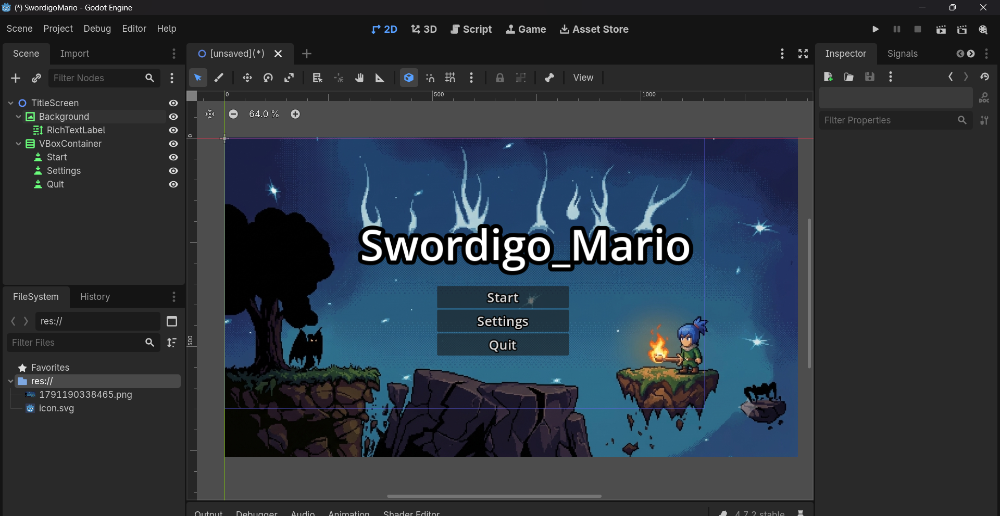
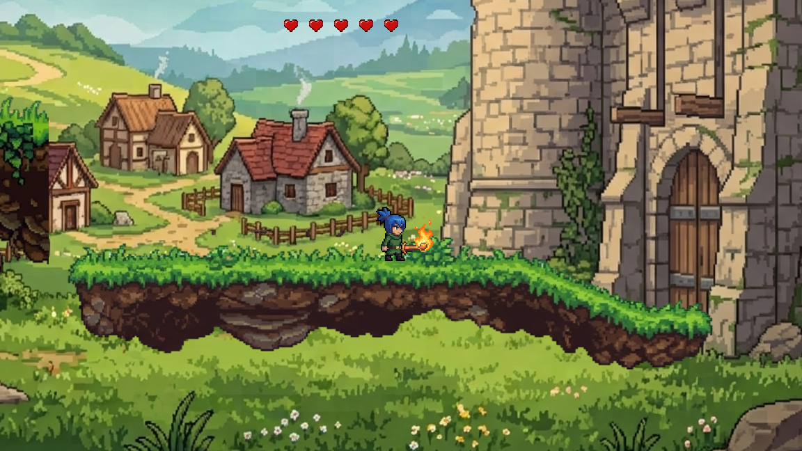
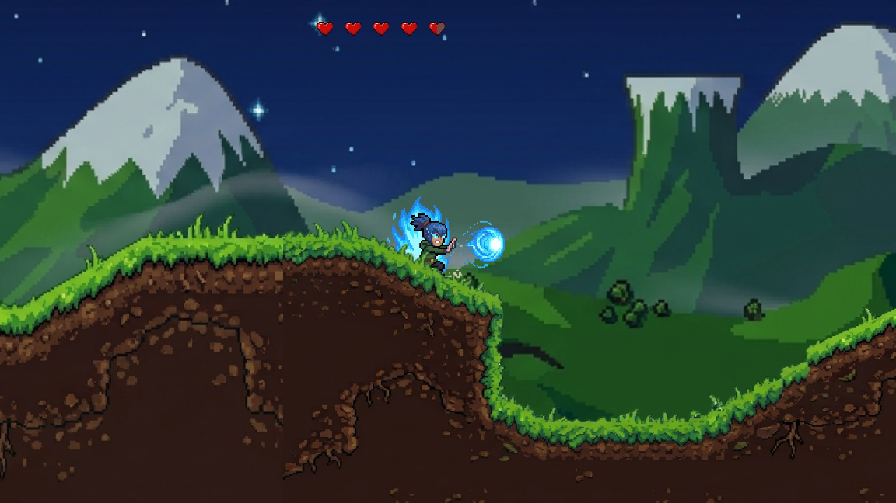

# SwordigoMario [BETA Version]
---
### Game Begins:-

---
### Interface and UI :-

---
### Protagonist Appearance :-

---

### HOW TO PLAY :-
Use left (←) and right (→) arrows to move!

Use the space button to jump!
Use MOUSE RIGHT CLICK BUTTON -> Attack
Use MOUSE LEFT CLICK BUTTON -> Casting Spell [Damage dealt by spell is under progress. Hope, in Next Update, We'll complete the full]

### Story of the Swordigo_Mario :-

Story is revolving about a young boy who goes on a journey after something terrible happens to his master. One day, he gets to know that his master is dead, and dark creatures called Corruptors are becoming a danger to the world.

Now he has to find a powerful magical sword called the Mageblade, which is the only thing that can stop these creatures. But his journey is not that easy. He has to travel through forests, caves, villages and dangerous places, where he fights enemies and discovers new powers.

As the story goes on, he finds out that the Mageblade has been broken into pieces, so he has to collect them and make the sword complete again. His master's spirit also helps him on the way.

In the end, he faces the main source of the darkness and fights to save the world. For me, Swordigo is not only about fighting enemies, it is also about courage, exploring new places and becoming stronger when life gives you difficult challenges.

---

### Visuals/Arts :-
https://www.pixilart.com/ :- For designing pixelated work and additionally I took help via my phone through Pixellabs.

### GDScript Tutorials :-
https://youtu.be/zHYkcJyE52g?si=PzgeIhijcpO71c9v -> for understanding the basics of making buttons.
https://youtu.be/V9kshvtj6s0?si=2OYFv96Xo20SFQxR -> for learning about sprites animation 2D.
https://youtu.be/oED12Mo2018?si=MKt242utlFfkgrCh -> I got some useful resources for my player code

--- 

### Help & Inspiration :-
https://en.wikipedia.org/wiki/Swordigo :- Huge Contribution to Touch Foo games because of them , I had experienced this game in my childhood and my one of the favourite games in offline and the idea is too Jaw dropping.
https://github.com/mairemare/WitchyWare/blob/main/README.md#witchyware :- For README Layout
---
This Project's Development is on the way and next time we do add more hostile mobs, better interactables, better story flow, more fighting ways and live the working of casting spell ,in future updates.... 
